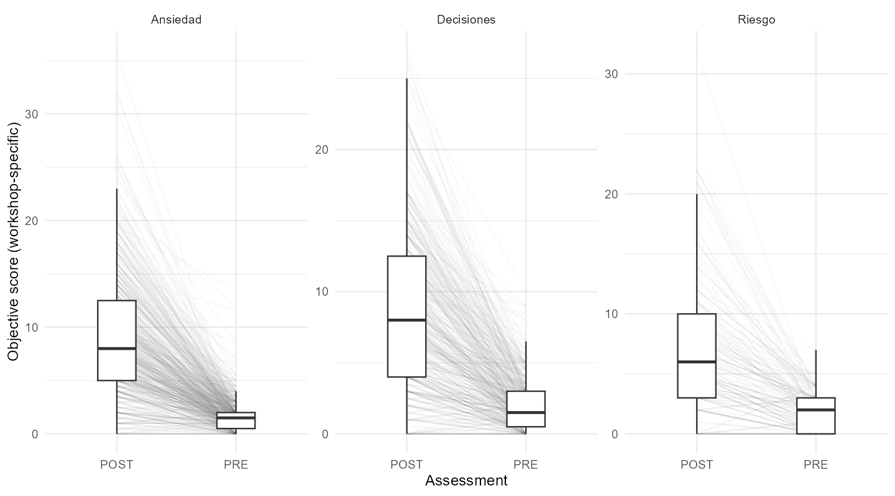

# Anxiety Knowledge in Education

This project examines changes in psychological knowledge after psychoeducational workshops in educational settings in Spain, mainly in Galicia. It brings together assessments from three workshops: **Anxiety, Decision-making, and Risk**. The aim is to understand what participants learn immediately after the workshops and use those findings to improve future assessments.

The Anxiety workshop introduces the links between situations, emotional and physical activation, thoughts, impulses, and behaviour. It gives participants concepts for understanding triggers and automatic responses, reflecting on their own thinking, describing their difficulties, seeking support, and exploring coping and regulation strategies. The workshops aim to give participants a foundation for developing practical skills.

## Research question

How does assessed knowledge change immediately after the workshops, how do those changes vary across topics and cohorts, and what do the responses tell us about the quality of the assessments?

## Data and measures

The dataset contains **1,090 paired pre/post assessment records** from **11 educational centres**, collected during the **2021/22, 2024/25, and 2025/26** academic years. It grew through routine workshop delivery; the original 2021/22 Anxiety study was smaller.

The study used a single-group pre/post design. Participants answered the same eight open-ended questions before and immediately after a workshop. Each workshop used its own questions and scoring system. **Assessed knowledge** is the sum of the scores for the eight responses. **Perceived knowledge** is a separate count, from 0 to 8, of how many questions participants believed they could answer.

The [conceptual framework](docs/conceptual_framework.md) covers perceived knowledge, recall and recognition, application in context, everyday behaviour, and retention over time. The existing assessments measure perceived knowledge and immediate recall through open-ended responses.

## Analysis

The completed historical analysis covered:

- Changes in total knowledge scores within each workshop.
- Changes in individual questions to identify differences across topics.
- Relationships between each item and the remaining assessment score.
- Differences in Anxiety scores and item relationships across cohorts.
- Exploratory analysis of the dimensions represented by post-workshop responses.

The analyses were conducted in R. Scripts, aggregate tables, and figures are included in this repository.

## Main findings

**Knowledge scores increased after all three workshops.**

| Workshop | Paired records | Mean before | Mean after | Mean change |
|---|---:|---:|---:|---:|
| Anxiety | 531 | 1.67 | 9.11 | +7.45 |
| Decision-making | 411 | 2.04 | 8.78 | +6.74 |
| Risk | 148 | 1.84 | 7.23 | +5.39 |

Full estimates are in the [results table](tables/prepost_change_by_workshop.csv).



**Changes varied across topics.** The [content learning map](figures/content_learning_map.png) shows which questions had larger or smaller gains. Total scores summarise overall change but hide these differences.

**Items generally related more closely to the rest of the assessment after the workshops.** Before the workshops, scores often clustered at the minimum, leaving little variation between participants. Anxiety score distributions and item relationships also varied across school years. See the [item-rest correlations](figures/item_rest_correlations.png).

**The exploratory dimensional analyses differed by workshop.** Risk showed the clearest evidence of a broad shared dimension across items. Anxiety from recent cohorts was more consistent with a single dimension than Anxiety pooled across years. Decision-making showed a more complex structure. The [scree and parallel-analysis figure](figures/scree_parallel_analysis.png) presents these results.

## What this means for assessment design

The results support reporting knowledge by topic alongside total scores. Item review will consider content, wording, scoring, response format, baseline variation, and cohort context.

Assessment design will address both content coverage and internal consistency. Documenting item versions, scoring rules, and administration will help interpret differences between future cohorts, including the Anxiety patterns observed across school years.

The [evidence-to-design table](docs/evidence_to_instrument_design.md) connects these findings to specific assessment decisions.

## Next steps

The next stage is to develop and pilot new assessments, starting with Anxiety.

The planned sequence is to define workshop objectives, map the content to be assessed, draft items, review their relevance and clarity, pilot them, and examine item performance and dimensional structure.

Proposed developments include:

- **Multiple-choice items** to standardise scoring and assess recognition alongside open-ended recall, which also depends on verbal expression and scoring.
- **Item-level perceived-knowledge judgements**, collected before participants see the response options, to examine how those judgements align with their answers.
- **Review of existing open responses** to identify misconceptions and develop incorrect answer options for multiple-choice items. This will involve coding and reviewing a sample of responses.
- **Matched, counterbalanced A/B forms** to reduce exact question repetition between pre- and post-assessment and compare form performance in pilot data.
- **Short scenarios** to assess application in realistic situations.

The [instrument development guide](instrument/README.md) describes the plans for item review, piloting, form comparison, and further psychometric analysis. The [workshop content framework](docs/workshop_content_framework.md) summarises the three content areas.

## Data access and reproduction

Participant-level source data, original questionnaires, and scoring keys are private. Analysis scripts and aggregate outputs are public.

To reproduce the analyses, authorised access to the source data, R, and the required packages are needed. Run the scripts in order from the repository root:

```r
source("R/01_prepare_data.R")
source("R/03_descriptives.R")
source("R/04_prepost_analysis.R")
source("R/05_content_learning_map.R")
source("R/06_historical_item_diagnostic.R")
source("R/07_dimensional_exploration.R")
```

The preparation script builds and checks the analysis dataset. The remaining scripts generate aggregate tables and figures.

## Project documentation

- [Conceptual framework](docs/conceptual_framework.md)
- [Evidence to instrument design](docs/evidence_to_instrument_design.md)
- [Workshop content framework](docs/workshop_content_framework.md)
- [Roadmap](ROADMAP.md)
- [Methodology](docs/methodology.md)
- [Data dictionary](docs/data_dictionary.md)
- [Limitations and future work](docs/limitations_and_future_work.md)

The original workshop and questionnaire framework was developed by **Brais Moldes Peña**. This repository covers secondary analysis, assessment evaluation, and future instrument development.
